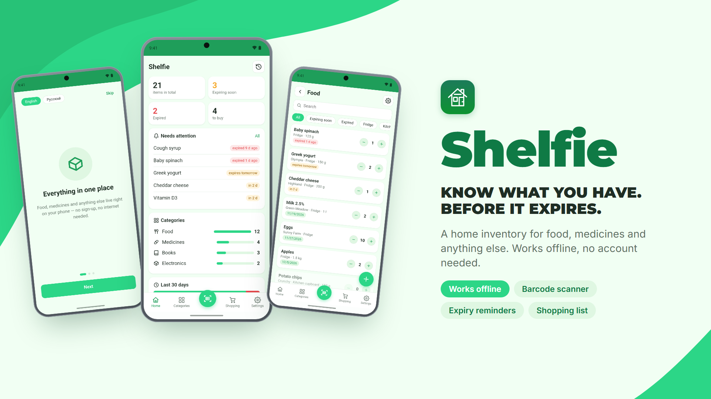
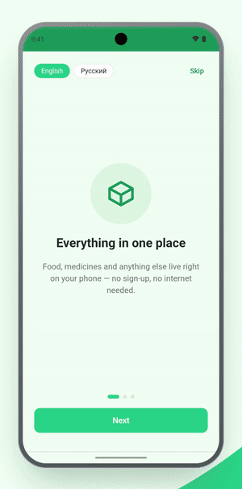
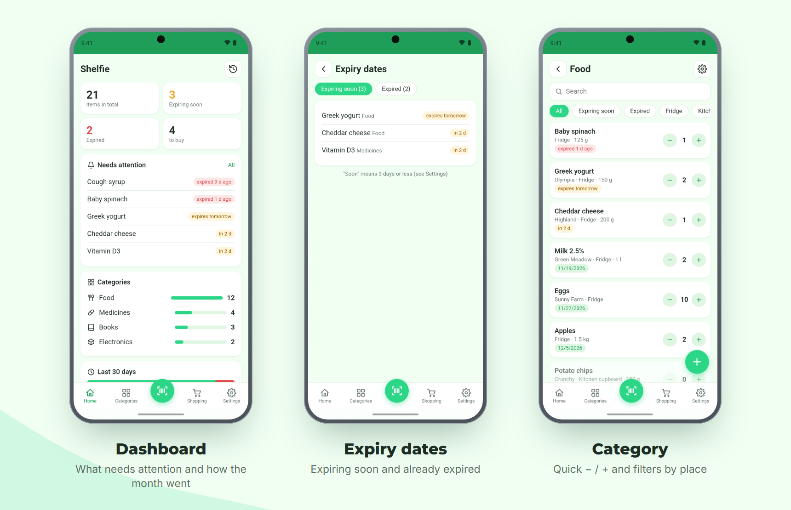
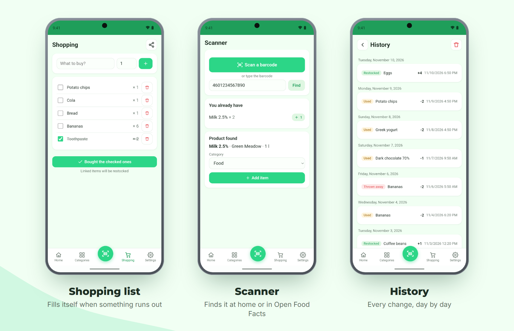
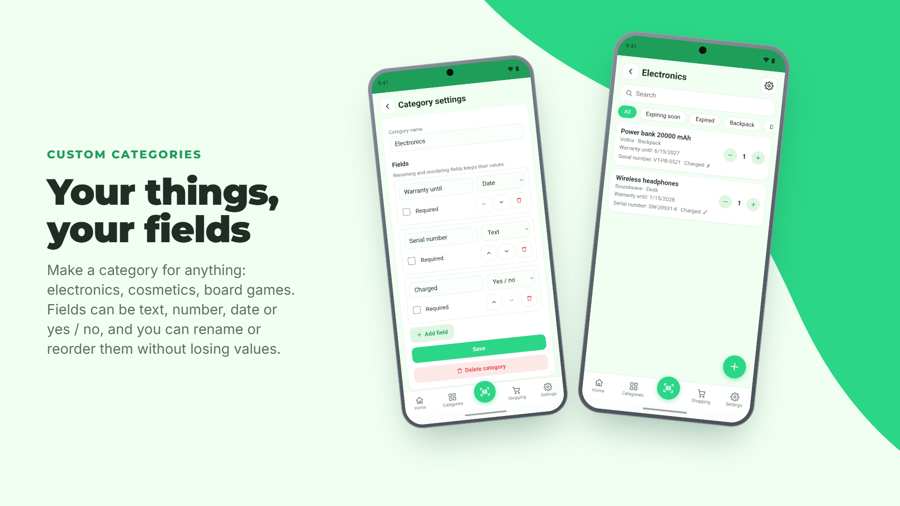

# 📦 Shelfie: smart home inventory

[](https://github.com/qwiklly/Shelfie/actions/workflows/ci.yml)

**English** · [Русский](README.ru.md)

Shelfie keeps track of what you have at home and reminds you before things go off. Food, medicines, books and anything else are stored on your phone, so you don't need an account or an internet connection. A server is optional and is only used to sync several devices.



Scan a barcode and the name, brand and size are filled in for you. Tap **−** when you use something. When an item runs out, it goes to the shopping list, and once you tick it off there, it is back in stock. A few days before something expires you get a notification, and the home screen shows how much you used and how much you threw away this month.

<p align="center">
  
</p>

---

## ✨ Features

- 📴 **Works offline.** Data is stored in SQLite on the phone. You can sign in to a server later, and your data will be uploaded then.
- 🔄 **Sync between devices.** Changes made offline are queued and sent when the server is available again.
- ⏰ **Expiry dates.** Lists of items that expire soon or have already expired, and a notification a set number of days before.
- 📷 **Barcode scanner.** Looks for the item in your inventory first, then in Open Food Facts for the name, brand and weight.
- 🛒 **Shopping list.** Items are added when they run out, the list can be shared, and **Bought the checked ones** puts them back in stock.
- 🧩 **Custom categories.** Food, Medicines and Books are built in. You can add your own categories with text, number, date or yes / no fields.
- 📍 **Storage places and photos.** Fridge, freezer, first-aid kit and so on. Photos stay on the device.
- 📊 **Statistics and history.** How much was used and thrown away in the last 30 days, and a log of every change.
- 👋 **First launch.** A short intro with a language choice, and hints on empty screens.
- 📤 **CSV export** and 🌐 **English and Russian** interface.

---

## 📷 Screenshots







---

## 🛠️ Tech stack

- **App:** .NET 10 MAUI Blazor Hybrid (Android), SQLite, ZXing barcode scanner, local notifications
- **Backend (optional):** ASP.NET Core 10 Web API, EF Core, PostgreSQL, JWT, Swagger
- **Tests and CI:** xUnit v3 (the API in memory and the offline core), GitHub Actions, Docker Compose

---

## 📦 Download

The latest APK is on the [Releases](https://github.com/qwiklly/Shelfie/releases/latest) page. The app works on its own. You only need a server to sync several devices.

## 🐳 Running the sync server

```bash
cp .env.example .env    # set the database password and the JWT key
docker compose up -d
```

The API starts on port `5111` (docs at `/swagger`). In the app, open **Settings → Account & sync**, enter `<your PC's IP>:5111` and sign in.

<details>
<summary><b>For developers</b>: project structure, running without Docker, tests</summary>

| Project | What it is |
|---|---|
| `Shelfie.Shared` | Contracts and rules shared by server and app |
| `ShelfieBackend` | ASP.NET Core API + PostgreSQL |
| `Shelfie.Client` | Offline core of the app: local database, sync, barcode lookup (plain .NET, unit-tested) |
| `MauiApp1` | The .NET MAUI Blazor app |
| `*.Tests` | xUnit v3 tests |

**Without Docker** you need the .NET 10 SDK with the MAUI workload and PostgreSQL:

```bash
cd ShelfieBackend
dotnet user-secrets set "ConnectionStrings:DefaultConnection" "Host=localhost;Database=shelfie_backend_db;Username=shelfie_user;Password=YOUR_PASSWORD"
dotnet user-secrets set "Jwt:Key" "A_RANDOM_KEY_OF_AT_LEAST_32_CHARACTERS"
dotnet ef database update
dotnet run --launch-profile http
```

Then run `MauiApp1` on an Android emulator. The emulator reaches your PC at `10.0.2.2:5111`.

**Tests:** `dotnet test --project ShelfieBackend.Tests` and `dotnet test --project Shelfie.Client.Tests`. No PostgreSQL needed.

**Upgrading a database from version 1.x:** back it up first (`pg_dump`). The `UnifiedInventory` migration moves the old tables into the new model and turns off the password of the demo `admin@example.com` account.

</details>

---

## 📄 License

This project is licensed under the [MIT License](LICENSE).
