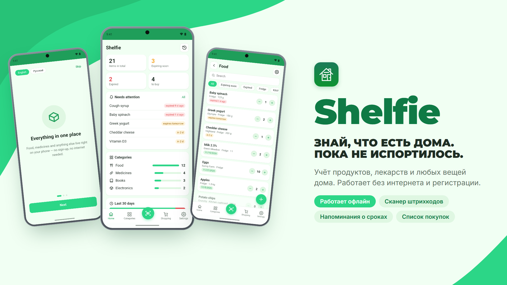
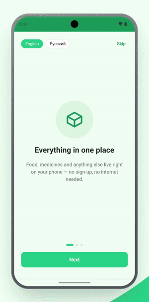
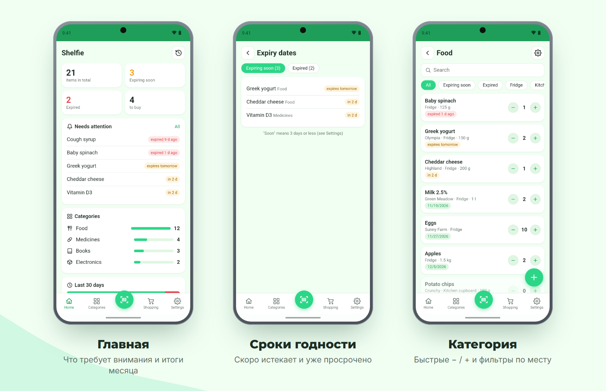
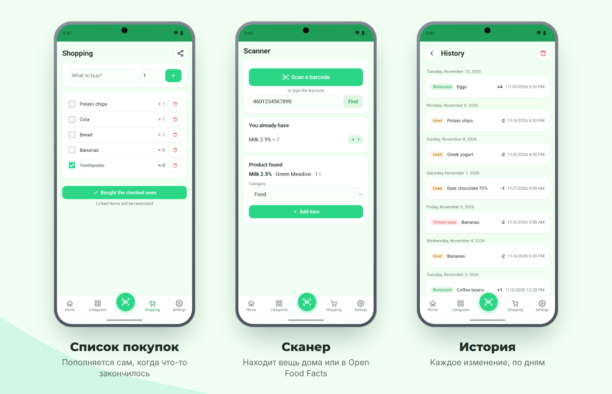
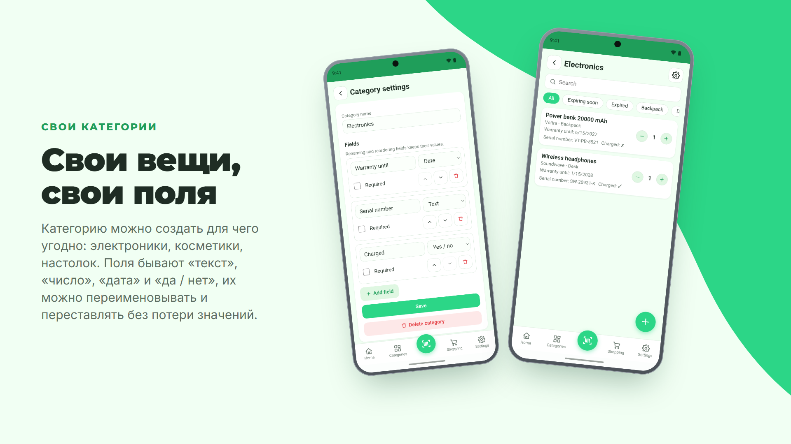

# 📦 Shelfie: учёт вещей дома

[](https://github.com/qwiklly/Shelfie/actions/workflows/ci.yml)

[English](README.md) · **Русский**

Shelfie помогает следить за тем, что есть дома, и напоминает о сроках годности. Продукты, лекарства, книги и другие вещи хранятся на телефоне, поэтому аккаунт и интернет не нужны. Сервер можно подключить по желанию, он нужен только для синхронизации нескольких устройств.



Отсканируйте штрихкод, и название, бренд и вес подставятся сами. Когда что-то использовали, нажмите **−**. Если вещь закончилась, она попадает в список покупок, а после отметки «Купил отмеченное» снова появляется в запасах. За несколько дней до конца срока приходит уведомление, а на главном экране видно, сколько за месяц использовано и сколько выброшено.

<p align="center">
  
</p>

---

## ✨ Возможности

- 📴 **Работает без интернета.** Данные хранятся в SQLite на телефоне. Войти на сервер можно позже, тогда данные туда и выгрузятся.
- 🔄 **Синхронизация между устройствами.** Изменения без сети копятся в очереди и отправляются, когда сервер снова доступен.
- ⏰ **Сроки годности.** Списки того, что скоро истекает и уже просрочено, и уведомление за заданное число дней.
- 📷 **Сканер штрихкодов.** Ищет вещь сначала в ваших запасах, потом в Open Food Facts (название, бренд и вес).
- 🛒 **Список покупок.** Закончившиеся вещи попадают туда сами, списком можно поделиться, а «Купил отмеченное» возвращает вещи в запасы.
- 🧩 **Свои категории.** Продукты, Медикаменты и Книги уже есть. Можно добавить свои категории с полями «текст», «число», «дата» и «да / нет».
- 📍 **Места хранения и фото.** Холодильник, морозилка, аптечка и так далее. Фото остаются на устройстве.
- 📊 **Статистика и история.** Сколько использовано и выброшено за 30 дней, и журнал всех изменений.
- 👋 **Первый запуск.** Короткое знакомство с выбором языка и подсказки на пустых экранах.
- 📤 **Экспорт в CSV** и 🌐 интерфейс на **русском и английском**.

---

## 📷 Скриншоты







---

## 🛠️ Технологии

- **Приложение:** .NET 10 MAUI Blazor Hybrid (Android), SQLite, сканер ZXing, локальные уведомления
- **Сервер (необязательно):** ASP.NET Core 10 Web API, EF Core, PostgreSQL, JWT, Swagger
- **Тесты и CI:** xUnit v3 (API в памяти и офлайн-ядро), GitHub Actions, Docker Compose

---

## 📦 Скачать

Свежий APK можно скачать на странице [Releases](https://github.com/qwiklly/Shelfie/releases/latest). Приложение работает само по себе, а сервер нужен только для синхронизации нескольких устройств.

## 🐳 Сервер синхронизации

```bash
cp .env.example .env    # задайте пароль базы и ключ JWT
docker compose up -d
```

API запустится на порту `5111`, документация доступна по адресу `/swagger`. В приложении откройте **Настройки → Аккаунт и синхронизация**, введите `<IP вашего ПК>:5111` и войдите.

<details>
<summary><b>Для разработчиков</b>: структура проекта, запуск без Docker, тесты</summary>

| Проект | Что это |
|---|---|
| `Shelfie.Shared` | Общие для сервера и приложения контракты и правила |
| `ShelfieBackend` | ASP.NET Core API + PostgreSQL |
| `Shelfie.Client` | Офлайн-ядро приложения: локальная база, синхронизация, поиск по штрихкоду (чистый .NET, покрыт тестами) |
| `MauiApp1` | Приложение на .NET MAUI Blazor |
| `*.Tests` | Тесты на xUnit v3 |

**Без Docker** понадобятся .NET 10 SDK с workload MAUI и PostgreSQL:

```bash
cd ShelfieBackend
dotnet user-secrets set "ConnectionStrings:DefaultConnection" "Host=localhost;Database=shelfie_backend_db;Username=shelfie_user;Password=ВАШ_ПАРОЛЬ"
dotnet user-secrets set "Jwt:Key" "СЛУЧАЙНЫЙ_КЛЮЧ_НЕ_КОРОЧЕ_32_СИМВОЛОВ"
dotnet ef database update
dotnet run --launch-profile http
```

Затем запустите `MauiApp1` на эмуляторе Android. Эмулятор видит ваш ПК по адресу `10.0.2.2:5111`.

**Тесты:** `dotnet test --project ShelfieBackend.Tests` и `dotnet test --project Shelfie.Client.Tests`. PostgreSQL не нужен.

**Обновление базы с версии 1.x:** сначала сделайте резервную копию (`pg_dump`). Миграция `UnifiedInventory` переносит старые таблицы в новую модель и отключает пароль демо-аккаунта `admin@example.com`.

</details>

---

## 📄 Лицензия

Проект распространяется по лицензии [MIT](LICENSE).
